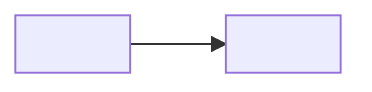

# <slug> — design brief

**Status:** <in progress | agreed YYYY-MM-DD> · **Repo:** `<absolute path, or "none yet">`
<at commit `<sha>` (branch `<branch>`)> · **Verdict:** <build | build smaller | don't build | open>

## Summary

<One paragraph: the problem, the chosen approach, and the expected result.>

## Problem

<The problem as someone has it today, with a concrete example. Not the solution.>

## Who and why now

<Who has it, how often, what they do about it today, and why it is worth solving now.>

## Success

- <A check someone can run or observe.>

**Failure looks like:** <what would make this not worth having built.>

## Constraints

- <Time, cost, tools and versions, compatibility, things that must not change.>

## Scope

**In:** <…>

**Out (non-goals):** <…>

**Later:** <pieces split off to brainstorm separately, or delete this line.>

## Approach

<The chosen design: the parts, how they connect, what happens when something fails, and how
you test it. Cite the docs for the version in use for each third-party behaviour you rely on.
Delete the diagram if the design has only one or two parts.>

<One or two sentences that tell what the diagram shows.>

## Alternatives considered

| Alternative | Why not |
|---|---|
| Do nothing / use what exists: <…> | <…> |
| <…> | <…> |

## Risks

| Risk (from the pre-mortem) | Mitigation, or "accepted" |
|---|---|
| <…> | <…> |

## Verification

- <How each part of the design is shown to work. Seeds campaign:plan's acceptance criteria.>

## Decisions

- **D1 — <question>.** Options: <a / b>. Recommendation: <a, because …>. <Open | Resolved YYYY-MM-DD: answer.>

## Disagreements

<!-- Where the brainstorm objected and the user chose otherwise. One line each side. -->

- **<topic>.** Objection: <…>. Chosen: <…>, because <the user's reason>.

## Assumptions

- <Things taken as true without checking. Each is a candidate risk.>
